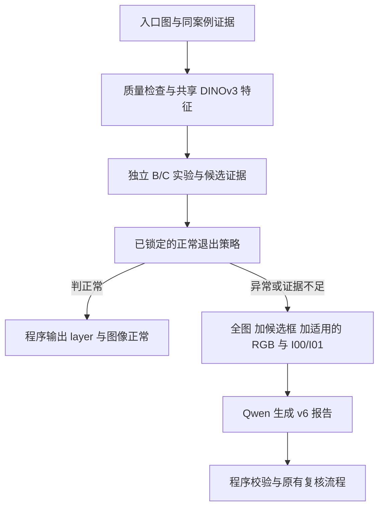

# SEM 异常检测方案：B/C 视觉实验与 Qwen 调用优化

日期：2026-11-11。状态：可执行的实验设计，尚无 B/C 实测结论。

## 1. 方案结论

第一阶段保持 DINOv3 冻结，开展 C（同案例正常参考视觉对应）与 B（单图内部结构异类）实验。C 优先验证候选定位，B 独立验证单图异常证据；分别评测后再决定采用哪条分支及是否融合。已有 DT-FS 留作固定对照。

正常/异常判定与候选定位分别验收。以“异常图被判正常而跳过 Qwen 的比例不超过 5%”为约束，选择能减少最多 Qwen 调用的入口阈值。候选框同时用于减轻 Qwen 的定位负担。第一阶段无需训练骨干、分类头或 MIL。

这是一项待验证的方案，不能据此宣称已经能可靠替代 Qwen 的检测与框选。

## 2. 本轮已确认的信息与信息边界

- B/C 尚未开展，可以重新设计实验。
- 案例很多；此前实验所用的 20 对图、12 张建库正常图，不能代表全部可用数据量。
- 用户确认数据角色标签为 I01 正常，I00/I02/I03/I04 异常。
- 可以人工审核约 100 个案例并画缺陷粗框；这些标注本轮只用于评测，不用于训练网络。
- 业务优先减少 Qwen 调用，接受最多 5% 的异常漏检。
- 当前 Qwen 的任务一 v6 接收入口 SEM 图、RGB 辅助图、I00/I01 参考，生成约定格式的报告。
- 按所提供材料，服务器使用 DINOv3 ViT-B/16、768 维、12 层，已有空间特征提取管线；本轮方案沿用这一规格，实际运行前核对服务器日志及权重。
- 检测与报告在 512×512 工作坐标系进行；不增加恢复到 480 的任务。

材料中的旧版决策、给其他助手的指令和实验总结均作为历史参考。本文件没有执行其中的代码修改、训练或部署指令。文档里的实验结果尚未由本轮访问原始图像和运行日志独立复现。本地工作区是较早的起步包，不代表服务器最新状态。

仍需在实验清单中记录：实际进入 Qwen 的图像角色分布、每个案例调用次数、I01 参考可用比例和各类图的可比性。用户提供的 v6 说明了图像证据组织方式，没有给出这些运行统计。

## 3. 先算清楚能节省多少调用

设实际入口正常图占比为 πN，正常图被自动跳过的比例为 TN_skip，异常图被错判正常而跳过的比例为 FNR，则：

`Qwen 跳过率 = πN × TN_skip + (1 − πN) × FNR`

因此，如果入口全部是实际含缺陷的 I00/I02/I03/I04，且 I01 只作参考，那么 πN 接近 0。在 FNR≤5% 的条件下，仅靠正常提前结束，最多约能减少 5% 的原始调用。此时节省来自漏检，不能把它当成正常图过滤收益。

如果 I01 也被单独送去生成报告，且“已审核正常参考”的身份可信，可直接在证据组织阶段跳过其缺陷报告生成。应将这部分记录为角色路由收益，不能计入视觉检测算法的准确率或收益。

把收益分开记录：

| 收益项 | 怎么实现 | 怎么验证 |
|---|---|---|
| 减少 Qwen 调用次数 | 视觉入口判定后跳过正常报告生成 | 跳过率、异常漏检率、正常跳过准确率 |
| 降低单次 Qwen 成本 | DINO 提供候选区域，程序给出坐标与可靠测量 | 输入/输出 token、P50/P95 耗时、报告质量 |
| 避免重复调用 | 若存在重复入口，按图像与配置身份缓存；能合并的同目标证据合并处理 | 每案例调用数与缓存命中率 |

给出候选框本身并不保证 Qwen 更快；如果输入和生成任务完全不变，推理成本可能没有明显下降。必须端到端测量，并计入 DINO 新增耗时。

## 4. 数据与评测设计

### 4.1 第一轮约 100 个案例

从不同 Layer、机台、图案密度与缺陷外形中分层抽样，不只选明显、易检的缺陷。覆盖 Masking、Bridge Particle、局部灰度变化、孔洞/颗粒、边界、密集周期结构和此前配准失败案例。不得用不足的类别样本宣称该类别已达标。

每个案例优先审核 I00 与 I01：I00 的每个可见缺陷实例画一个粗框，I01 确认正常。额外记录缺陷是否极小、是否多实例、图案是否重复，以及是否存在人工无法可靠判读的区域。标签有争议的图单列，不能硬塞进正常或异常真值。

建议分配为 20 个开发案例、20 个阈值校准案例、60 个锁定测试案例。旧实验中反复使用的案例全部进入开发集。若独立案例不足以这样划分，减少结论强度，不反复借用测试集调参。

同案例全部视图、同一物理缺陷的重复拍摄、同晶圆同位置的近重复图必须处于同一组。有批次信息时另做跨批次检查。I02/I03/I04 是同一目标的相关通道，不能当成三个独立案例扩大统计样本量。

### 4.2 正常对照的构造

B 可分别处理审核后的 I00 和 I01，形成同成像模式下的正常/异常图像级评测。文件名可用于取图和真值组织，但不进入异常分数计算；移除或统一非样品边框、文字叠加等干扰，避免依赖采集标记判断。

C 用 I00 作待检图、同案例 I01 作参考，可评估异常定位与检出。但评估 C 的正常误报时，需要正常待检图与另一张独立、可比的正常参考。禁止 I01 与自身或完全相同内容的副本比较。

优先使用同位置的独立正常重复采集。若只能选择其他案例 I01，必须人工确认图案、视场、倍率与探测模式可比，并将这种跨案例参考结果单独报告。不能在正例使用同案例精确参考、负例使用不相干参考后，把两者当成完全相同的评测条件。

对 I01 做小位移、轻微噪声等变换，可检查算法是否对这些扰动过敏；这些属于受控测试，不替代独立正常图对。如果没有足够的正常图对，C 本轮只能验收异常候选定位，不能验收其正常提前结束能力。

## 5. 算法设计

### 5.1 共同底座

复用服务器现有单实例冻结 DINOv3。保留原有 CLS 类型一致性功能，同时输出空间特征。先用一基编号第 8、12 层，分别保存结果，确认单层价值后才做固定规则组合。

对实际 timm 实现核对：层编号、CLS 与 register/storage 等非空间 token 的排除、LayerNorm 与通道 L2 归一化、网格展平顺序。512 输入、patch16 的空间网格应为 32×32；不能把全 token 序列直接 reshape。官方 DINOv3 源码提供了中间层输出与空间 token 分离的参考，但实际接口以部署版本为准。[官方特征提取实现](https://github.com/facebookresearch/dinov3/blob/main/dinov3/models/vision_transformer.py)

各分支统一有效样品区域，排除补边、标尺文字等无关区域，保留掩膜和覆盖率。不能根据缺陷真值掩蔽难检区域。

每个 patch 特征包含上下文信息。16 像素是空间采样步幅，不等于特征只观察 16×16 局部，也不代表插值热力图能够获得像素级轮廓。

### 5.2 C1：同案例局部视觉对应

目标：利用同案例 I01 中的正常图案，解释待检图的局部结构，找出解释不好的区域。无需先生成像素级重叠图，但仍要处理对应关系的不确定性。

1. 核对 I00/I01 的成像可比性，提取两图相同层的空间特征。
2. 为待检 patch 建立参考图中的候选搜索窗口。根据开发集偏移和采集元数据设置范围，窗口只是位置先验，不代表已经精确对齐。
3. 计算归一化特征的余弦距离，保存前若干个候选匹配、位置和位移；不只保存最近邻距离。
4. 用可靠背景匹配的位移共识辅助约束窗口。周期图案可能出现多个合理位移，先保留多假设，避免过早选错周期。
5. 分别输出匹配残差、匹配歧义、有效覆盖率与候选框。

大距离可能来自缺陷，也可能来自参考不可比；小距离也可能是异常错误匹配到了其他正常结构。因此 C1 只是最低可行实验。

### 5.3 C2：邻域结构验证

在 C1 的候选对应上，检查待检中心与周围 patch 能否由参考图的同一邻域、相容位移共同解释。使用保留相对位置的邻域描述，而不是把所有邻居做均值后丢掉排列。

比较 C2 是否能减少密集孔洞、平行线和桥连场景中的错误正常匹配。互相最近邻、循环一致性、邻域残差可作为诊断量；对重复图案不把“不是唯一匹配”直接判缺陷，也不把所有歧义区域压成零异常分数。

参考不适用或对应无法建立时输出证据不足，交给后续流程。背景大面积匹配失败与局部缺陷残差必须区分记录。

### 5.4 B1：单图内部异类

在同一张图中，比较空间上分离的 patch，排除自身及过近位置，计算图内近邻距离。用于回答“缺陷是否比同图其他结构更特殊”。

搜索排除半径在开发集确定，并记录可用同类区域数量。B1 不能把合法的少数边界、角点或特殊正常结构自动等同于缺陷。大面积或重复出现的异常也可能互相成为近邻而漏检。

### 5.5 B2：用上下文寻找可比同类结构

更贴近用户“从重复图案里看出异类”的想法：先以中心周围的结构上下文寻找同类位置，再检查中心本身是否偏离这些位置应有的外观。

1. 为中心构造保留空间排列的邻域描述，第一版将中心从同类区域选择描述中排除，减少缺陷自己决定匹配对象的影响。
2. 在图内选择空间分离、上下文相似的若干同类区域。
3. 用这些区域中心特征的稳健距离统计，衡量当前中心的偏离程度。
4. 同时保存匹配到的同类区域，便于人工判断是否真的在比较同一种结构。

如果图内没有足够可比结构，B 对该区域应给出证据不足。不能把“找不到同类”强行解释为异常或正常。B2 的具体设计属于本项目实验假设，不是已有论文已证明的 SEM 能力。

### 5.6 灰度变化与微小缺陷专项

视觉编码器可能对局部灰度变化不敏感。保留一个独立的局部统计对照，只在对应可信的区域比较局部均值等量，观察它是否补充检出。不要重新将全图像素差分作为主路线，也不预先融合这一证据。

补充 OpenCV 灰度处理分支，第一轮作为独立对照，不预设其优于 B/C，也不需要训练。使用同一批审核案例与划分，分别验证：

| 使用方式 | 实验内容 | 适用边界 |
|---|---|---|
| 单图局部灰度统计 | 将局部均值、方差和边缘响应与图内可比的正常结构比较 | 正常图案边界本身也有响应；不能拿任意周围像素当正常背景 |
| 双图局部灰度比较 | 在对应可靠区域计算灰度残差及局部统计差异 | 亚像素错位、探测器差异和整体采集变化都可能造成伪异常 |
| 候选区域细化 | 在 DINO 候选区域内利用灰度、边缘与形态学细化异常范围，提取连通域和轮廓 | 属于定位细化；DINO 漏掉的区域不会因此自动找回 |

参考处理链为：保留位深的灰度读入 → 掩蔽无关边框与文字 → 轻度去噪 → 建立可比背景或局部对应 → 灰度/边缘/局部统计残差 → 用校准集确定阈值 → 谨慎的形态学处理 → 连通域与轮廓 → 候选框及可靠几何测量。OpenCV 提供阈值化、连通域与轮廓处理等基础工具，但这些工具不自带 SEM 缺陷定义。[OpenCV 阈值化说明](https://opencv.org/image-thresholding-using-opencv/)与[形状分析文档](https://docs.opencv.org/4.0.0/d3/dc0/group__imgproc__shape.html)

双图差异可用 `absdiff`；若计算有正负方向的灰度差或局部均值差，应先转浮点，避免无符号整数减法溢出。不要默认所有原图都是 8 位，或套用固定的“灰度差大于某值即缺陷”规则。若局部灰度变化本身是目标信号，不先通过强直方图均衡或归一化把它消掉。

此前全图灰度差分已经出现边缘误报，本轮不原样重复。重点观察局部可比区域与结构条件能否增加价值。灰度接近、主要改变连接关系的 Masking 等缺陷，仍需结构证据；不能以局部灰度残差低直接判正常。不同探测器的 I02/I03/I04 也不能未经校准直接互相减灰度。

这些内部数值可用于检测；最终报告遵守 v6，不输出被禁止的颜色、明暗或物理成因表述。

如果缺陷在当前网格上没有稳定信号，做一次局部裁剪放大后输入同一骨干的诊断实验，坐标映回该入口的 512 工作画面。不要把插值当成分辨率提升。裁剪不能恢复原始采集中不存在的细节，也不能在正式评测时用真值框告诉算法裁哪里。

## 6. 正常/异常判定与 5% 漏检预算

### 6.1 分数与显示分离

保存原始距离/结构残差。图像级分数先比较少量预先规定的聚合方式，例如有效网格上最高 1%、3%、5% 分数的均值；在校准集选定一种后锁定。这里的比例只是候选配置，不是已验证参数，也不是缺陷概率。

热力图使用固定色标或固定校准统计量显示。逐图 min-max 图仅可另存用于观察位置，不能用于跨图阈值判定。DT-FS 原文也明确指出逐图缩放丢失绝对偏离信息，影响图像级检测。[DT-FS 原文](https://www.mdpi.com/2079-9292/15/21/5060)

### 6.2 入口规则

在分支适用、有效区域覆盖充分、数据条件属于已验证范围时：

- 分数低于选定的退出阈值：判为正常，程序直接生成 v6 正常两行文本，跳过 Qwen。
- 分数较高：保留异常候选，交给 Qwen 描述。
- 质量不足、分支不适用或证据冲突：交给 Qwen 继续处理，内部状态为 insufficient_evidence。

“没有候选框”不能直接等价于“正常”。B 与 C 首轮分别运行和评测，不能临时调权重融合以追求测试集好看。将来若选择组合，整个组合规则都要重新校准、锁定并测试，不能只引用单分支指标。

### 6.3 阈值选择目标

在校准集上选择使 Qwen 跳过率最大的阈值，同时满足：

`FNR = 被判正常并跳过的真实异常图数 / 真实异常图总数 ≤ 5%`

选择后在锁定测试集一次性报告结果。证据不足进入 Qwen，不计为自动检出成功；另外报告自动判定覆盖率。

5% 是总体预算，还要列出各缺陷类、Layer、大小组的漏检，避免总体达标而某类完全漏掉。再报告“被跳过的图中实际异常占比”，它与上述 FNR 不同，且依赖真实入口正常比例。

有限测试样本只能提供有限证据。若 60 个独立异常案例测试中零漏检，二项模型下一侧 95% 漏检率上限约为 4.87%；若恰好漏 3/60，虽然点估计为 5%，却不能据此声称真实漏检率的 95% 上限低于 5%。相关视图不能当独立样本重复计数。正式放量还需扩大独立测试与运行观察。

如果全部阈值都只能做到几乎不跳过，结论是这批证据尚不能带来有用的调用节省，不能通过放宽用户的 5% 预算掩盖这一点。

## 7. 与任务一 v6 的衔接

图中入口策略只在通过独立验收后启用；实验阶段先旁路记录“本来会跳过哪些图”，仍保留完整报告以比较损失。

- 输出正文继续遵守 v6。正常只输出 `layer：…` 与 `图像正常` 两行。分数、方法版本、质量状态、证据身份保存在内部 JSON，不添加到报告正文。
- 每个框带 `source_view` 与 `target_id`，始终属于第一张入口 SEM 图的 512 坐标系。I00 的框不能直接用作 I02 的框。
- I02/I03/I04 的 RGB 合成与 I00 之间的视野关系需要验证；不因尺寸相同就默认几何对应。第一轮先处理 I00/I01，再单独验证其他入口通道。
- Qwen 继续扫描完整入口图。实验候选框作为辅助证据，避免只看候选框而漏掉第二处缺陷。是否缩减全图扫描任务，要以完整实例标注的对照结果决定。
- 粗框只能说明候选范围。精确长短轴和方向需要可信轮廓；不能拿松框的宽高冒充缺陷轴长。
- 轮廓可靠时由程序计算主轴、长短轴；近圆形方向填“无”。v6 角度约定下，可由图像坐标主轴向量 `(vx,vy)` 计算 `atan2(-vy,vx) mod 180°`，再映射方向词。
- 物理尺寸只在入口原图比例尺可靠时输出，且比例尺必须与该 512 工作图的缩放一致；否则按 v6 填“尺寸：未呈现”。RGB 不提供入口图的比例尺。
- 检测实例数与报告的类型分组数分开保存。v6 中“存在 X 处缺陷”按类型分组，算法的候选连通域数量不能直接填入 X。

v6 中仍有两个会影响验收的冲突：一处要求主缺陷类型必须与机台标签完全一致，另一处要求标签与图像冲突时以图像为准；一处按空间分离计数，最终格式又按类型分组。检测模块先输出几何实例与来源，不自行更改类型规则；正式报告验收前需明确主缺陷类型冲突的优先级，并用“类型组/实例”区分计数。

## 8. 实验矩阵、交付与停止条件

| 阶段 | 实验 | 交付与判定 |
|---|---|---|
| P0 | 审核约 100 案例，完成粗框、分组与数据身份清单 | 明确真值、入口比例、成像可比性、测试集锁定 |
| P1 | 已有 DT-FS 固定基线；B1；C1 | 同一案例的独立分数、匹配证据、候选框、耗时、错误原因 |
| P2 | B2；C2；必要的灰度变化/局部裁剪诊断 | 验证结构约束是否带来独立增益，不增加大批调参组合 |
| P3 | 单分支正常退出阈值校准与锁定测试 | FNR、跳过率、正常误报率、覆盖率、各类漏检与置信区间 |
| P4 | 对照现有 Qwen 完整流程 | 每案例调用数、token、总耗时、完整报告与多缺陷覆盖质量 |

候选定位先报告每图最多 1/3/5 个框时的实例召回与误框数，并同时报告候选面积占图比例。粗框验收可预先约定 IoU≥0.3 作为较宽松的候选命中标准，并补充 IoU≥0.5；这只是本轮候选框口径，不等于精确定位达标。不能让一个覆盖全图的大框以“包含缺陷”为由算成功，也不能只展示高亮热力图。

保留每例失败原因：背景误报、参考不可比、周期错配、图内同类不足、微小缺陷无响应、局部灰度变化无响应、实例合并/遗漏等。没有全量实例审核时，误框率与实例召回不能宣称为完整真值指标。

建议代码落在服务器既有 `src/sem/modules/normal_anomaly_detection/`，以现有实际目录为准。只新增共享特征接口、B/C 评分与证据、候选框、阈值策略和离线评测，避免重写流水线。现有 DT-FS、旧配准和 Qwen 基线保持可复现。

最终交付应包括：数据与划分清单、人工审核与粗框、固定实验配置、逐例结果与失败清单、阈值配置与版本、性能汇总、Qwen 端到端收益表。缓存身份包含图像哈希、模型权重、预处理、层编号、算法与阈值版本；Qwen 缓存另含提示词和生成配置。

如果 B/C 在固定候选预算下没有改善召回或误报，或 5% 漏检约束下没有有用的调用节省，停止继续堆叠启发式参数。届时再用这批人工审核数据评估冻结特征的轻量监督头或定位头，作为后续方案选择；不预先判定必须微调 DINOv3，也不自动启动训练。

## 9. 参考资料及适用范围

1. [DINOv3，官方论文](https://arxiv.org/abs/2508.10104)及[官方仓库](https://github.com/facebookresearch/dinov3)：支持冻结视觉特征与密集下游应用的技术基础，不保证 SEM 缺陷已可分。
2. [DINOv3 中间层输出源码](https://github.com/facebookresearch/dinov3/blob/main/dinov3/models/vision_transformer.py)：用于核对空间 token 与中间层特征提取约定，部署 timm 版本仍需单独检查。
3. [DT-FS，Electronics 2026](https://www.mdpi.com/2079-9292/15/21/5060)：作为双层正常特征检索及评分归一化的参考。当前原文使用 ViT-S/16、560 输入、一基第 9/12 层；本项目 ViT-B/16、512、第 8/12 层属于改造配置，不能称逐项复现原论文。以上只引用方法与局限，不移植其基准分数作为本项目承诺。
4. [AnomalyDINO，WACV 2025](https://arxiv.org/abs/2405.14529)：提供冻结 DINOv2、patch 相似性与少样本正常参考的参考；不等于本项目的单图 B 或带空间关系的 C 已有验证。
5. [Classifying Texture Anomalies at First Sight，作者项目页](https://reality.tf.fau.de/publications/2024/ardelean2024classifying/ardelean2024classifying.html)：单图内部统计发现纹理结构异常的相关研究，适用边界以纹理结构异常为主，不能据此保证多种 SEM 逻辑异常可检。

本方案中的 B2/C2、阈值选择、数据划分与集成方式是针对本项目提出的实验设计。它们的有效性由本轮独立数据决定。
